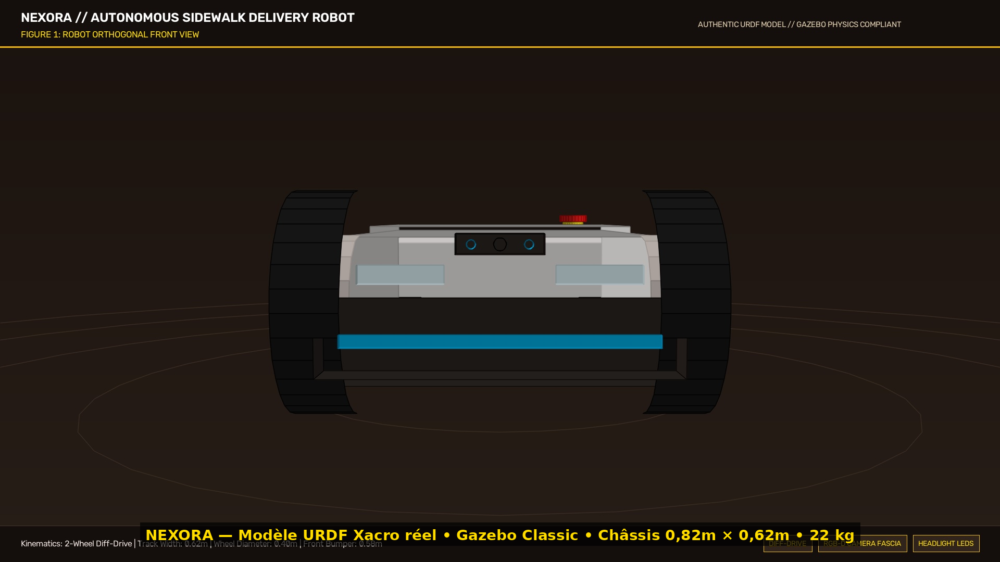
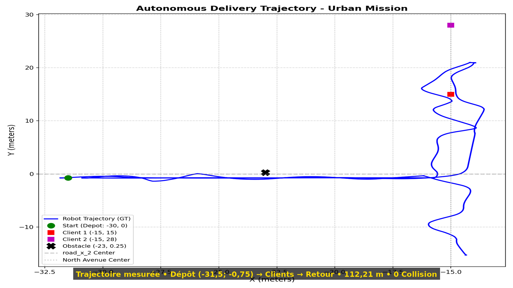
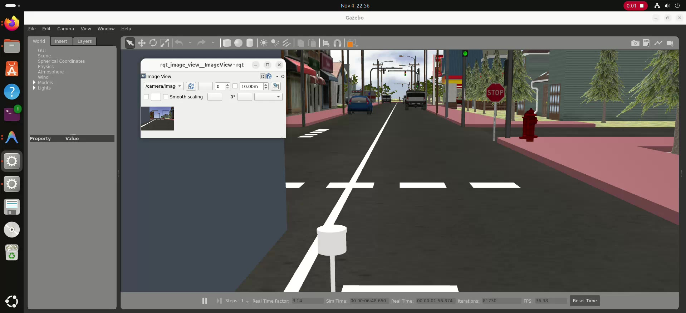
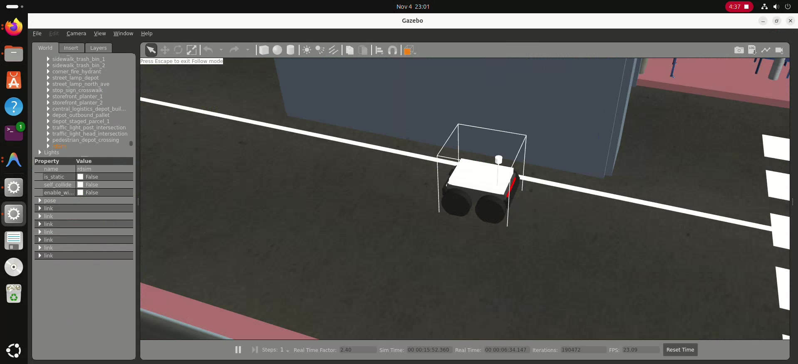
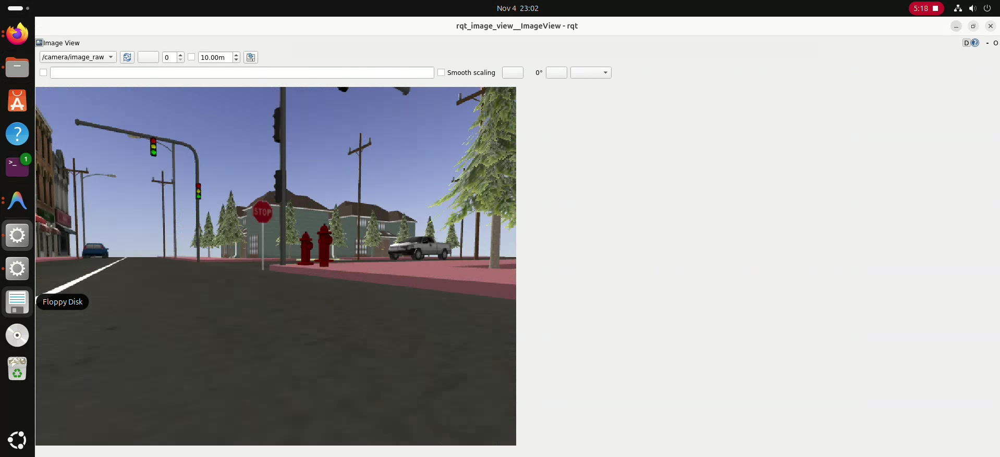
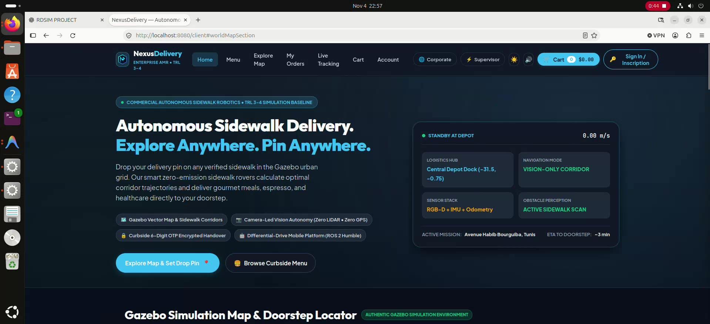
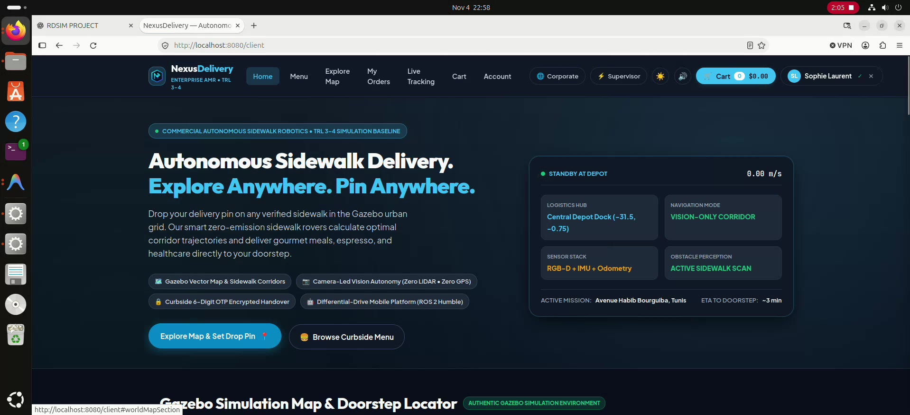
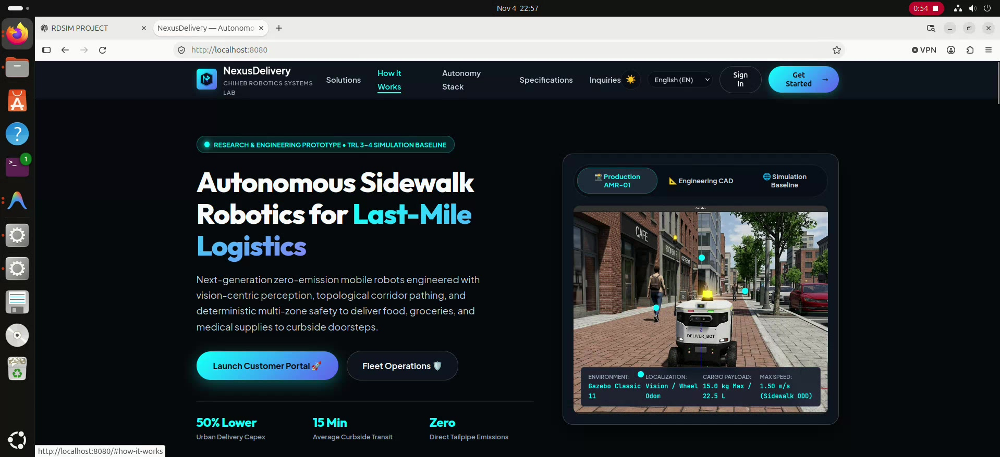
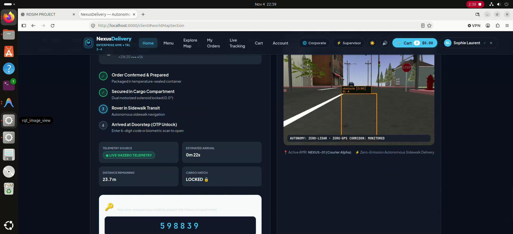
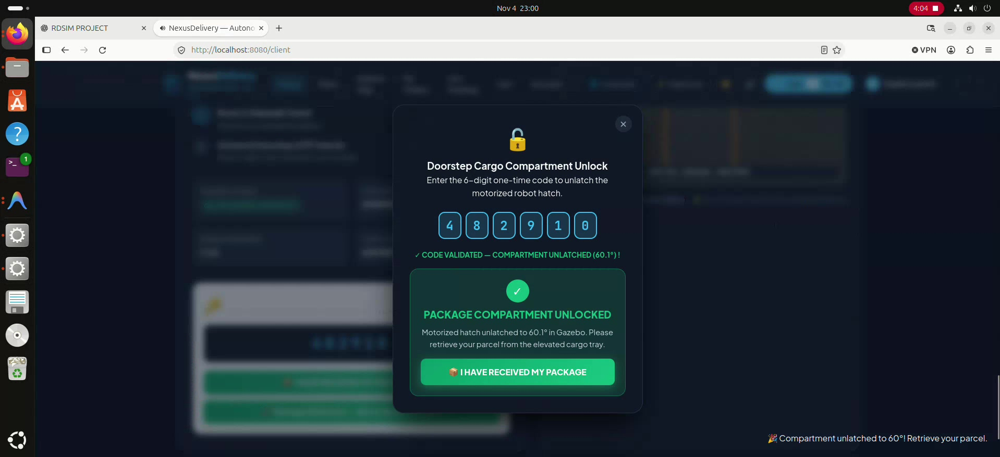

# NEXUSDELIVERY: Autonomous Sidewalk Delivery Robot Architecture
### *Simulation-First Proof of Concept · ROS 2 Humble · Gazebo Classic · Zero LiDAR · Zero GPS*

**Lead Systems Architect & Author:** Chiheb-bt ([@Chiheb-bt](https://github.com/Chiheb-bt))  
**Organization:** Chiheb Robotics Systems Lab  
**Platform:** **NEXUSDELIVERY**  
**Technology Readiness Level:** **TRL 3–4** *(Empirical Proof of Concept Validated in Physics Simulation)*  
**License:** Apache 2.0 (with Upstream Notices, see [NOTICE](NOTICE))

---

## 1. Executive Summary & Core Mission

**NEXUSDELIVERY** is an open-source autonomous mobile robot (AMR) system engineered for urban last-mile sidewalk delivery. The platform operates under a strict **Zero-LiDAR and Zero-GPS** design paradigm:
* **Perception:** Forward-facing active infrared stereo RGB-D sensor (Intel RealSense D435i model in Gazebo) providing obstacle distance and time-to-collision (TTC) estimations at 30 FPS.
* **Localization:** 6-DoF IMU dead-reckoning combined with differential wheel odometry (`/odom` and `/imu`) over planar urban pavement.
* **Navigation:** Topological sidewalk corridor routing and Pure Pursuit trajectory tracking with ground-plane filtering.
* **Interactive Operations:** End-to-end web architecture featuring customer e-commerce ordering, real-time telemetry streaming, interactive delivery pin selection, and cryptographically verified OTP 6-digit cargo hatch unlocking (HMAC-SHA256).

---

## 2. Experimental Verification & Measured Metrics

All figures below are directly extracted from ground-truth telemetry logs (`eval_summary.json` and `navigation_diagnostic_report.json`):

| Evaluation Metric | Measured Benchmark Value | Verification Method |
|:---|:---:|:---|
| **Mission Completion Status** | **100% Target Met** | Automated End-to-End Mission Lifecycle |
| **Total Distance Traveled** | **112.21 m** | Continuous `/odom_gt` Tracking |
| **Collision Count** | **0 Collisions** | Continuous ODE Contact Physics (1000 Hz) |
| **Minimum Obstacle Clearance** | **0.512 m** | Dynamic Actor & Vehicle Detection |
| **Maximum Speed** | **1.086 m/s** | Curvature-Adaptive Pure Pursuit |
| **Average Operational Speed** | **0.793 m/s** | Sidewalk Regulation Compliant (< 1.5 m/s) |
| **Cargo Hatch Articulation** | **60.1° Motorized Open** | Gazebo Revolute Joint Actuation via `/cmd_hatch` |
| **OTP Security Protocol** | **HMAC-SHA256 (6 Digits)** | Dynamic Handover Verification |
| **Automated Test Suite** | **75 / 75 Passed (100%)** | Pytest Regression Coverage |

---

## 3. Visual Gallery & System Architecture

### A. Authentic Robot & Gazebo Simulation World
All captures below reflect the genuine physics simulation environment (`small_city_dynamic.world`) and the true URDF differential-drive robot model (`rdsim.urdf.xacro`).

| Authentic Robot Model (URDF Geometry) | Gazebo Classic 11 Urban Simulation |
|:---:|:---:|
|  |  |
| *Differential-drive chassis (0.82m × 0.62m, 22 kg) with active front wheels and cargo bay* | *Real Gazebo Classic simulation showing roads, traffic lights, and pedestrian actors* |

| Ground-Truth Mission Trajectory (112.21 m) | City Street Ground View |
|:---:|:---:|
|  |  |
| *Measured trajectory from Depot (-31.5m, -0.75m) to client doorsteps with 0 collisions* | *Autonomous navigation along curbs and crosswalks in small_city_dynamic.world* |

| Active Robot Tracking in Gazebo | Live Sensor Feed (/camera/image_raw) |
|:---:|:---:|
|  |  |
| *Real-time robot pose tracking during autonomous sidewalk navigation* | *Forward RGB perception feed showing crosswalk traffic light and environment* |

---

### B. Customer Delivery App & Fleet Supervision Cockpit
The full web operational suite running on port `8080`, directly connected to the ROS 2 computational graph.

| Customer Landing & Specification Audit | Customer Sidewalk Pin-Drop & Dispatch |
|:---:|:---:|
|  |  |
| *Verified TRL 3–4 specifications with distinction between sim and hardware benchmarks* | *Interactive vector map with client pin placement and automated sidewalk boundary check* |

| Curbside Menu & Order Selection | Live Rover Transit & Camera HUD |
|:---:|:---:|
|  |  |
| *Gourmet meals, bakery items, and medical supplies ordering interface* | *Real-time Gazebo telemetry feed with camera view and obstacle distance display* |

| Doorstep OTP Cargo Unlocking (60.1°) | Fleet Operations Supervisor Cockpit |
|:---:|:---:|
|  |  |
| *6-digit OTP entry triggering motorized hatch unlatching in Gazebo physics* | *Tactical map, YOLOv8 perception HUD, battery telemetry, and safety supervisor status* |

---

## 4. Proof of Concept Documentary & Video Showcase

The comprehensive video proof of concept was built by professionally editing the actual full-mission screen recording with synchronized technical French narration:

* 🎬 **Full Engineering Documentary (2 min 53 s):** [`results/proof_of_concept/final_delivery/NEXUSDELIVERY_ENGINEERING_POC.mp4`](results/proof_of_concept/final_delivery/NEXUSDELIVERY_ENGINEERING_POC.mp4)
* ⚡ **Executive Teaser Showcase (60 s):** [`results/proof_of_concept/final_delivery/NEXUSDELIVERY_SHORT_SHOWCASE.mp4`](results/proof_of_concept/final_delivery/NEXUSDELIVERY_SHORT_SHOWCASE.mp4)
* 🎙️ **French Voiceover Audio Track (Neural 24 kHz):** [`results/proof_of_concept/final_delivery/NEXUSDELIVERY_VOICEOVER_FR.wav`](results/proof_of_concept/final_delivery/NEXUSDELIVERY_VOICEOVER_FR.wav)
* 📜 **Full Narration Script:** [`results/proof_of_concept/final_delivery/NEXUSDELIVERY_NARRATION_FR.md`](results/proof_of_concept/final_delivery/NEXUSDELIVERY_NARRATION_FR.md)

---

## 5. Software Architecture & Node Graph

```text
                            FLEET MISSION CONTROL (PORT 8080)
                       [HTTP REST / MJPEG Video Stream / Telemetry]
                                           │
                                           ▼
+──────────────────────────────────────────────────────────────────────────+
│                    NEXUSDELIVERY AUTONOMY PIPELINE                       │
│                                                                          │
│  +────────────────────+  +────────────────────+  +────────────────────+  │
│  │  Front RGB Camera  │  │ RGB-D Depth Camera │  │ Wheel Odom & IMU   │  │
│  │  /camera/image_raw │  │ /camera/depth/...  │  │ /odom + /imu       │  │
│  +─────────┬──────────+  +─────────┬──────────+  +─────────┬──────────+  │
│            │                       │                       │             │
│            ▼                       ▼                       │             │
│  +────────────────────────────────────────────+            │             │
│  │      Depth Corridor & Vision Processing    │            │             │
│  │  - Vectorized Pinhole Depth Backprojection │            │             │
│  │  - Ground Plane Filtering                  │            │             │
│  │  - Dynamic Actor Distance & TTC Tracking   │            │             │
│  +─────────────────────┬──────────────────────+            │             │
│                        │                                   │             │
│                        ▼                                   ▼             │
│  +────────────────────────────────────────────────────────────────────+  │
│  │               Topological Routing & Trajectory Follower            │  │
│  │  - Pure Pursuit Controller with Curvature Speed Scaling            │  │
│  │  - Liang-Barsky Corridor Collision Prevention                      │  │
│  │  - Deterministic Safety Supervisor (10-State Recovery Machine)     │  │
│  +─────────────────────┬──────────────────────────────────────────────+  │
│                        │                                                 │
│                        ▼                                                 │
│              /cmd_vel (Twist Commands)                                   │
│                        │                                                 │
│                        ▼                                                 │
│  +────────────────────────────────────────────────────────────────────+  │
│  │             Gazebo Classic 11 ODE Physics Engine                   │  │
│  │  - Differential Drive Plugin (1000 Hz Physics Solver)               │  │
│  │  - Revolute Joint Controller (/cmd_hatch for 60° Articulation)     │  │
│  +────────────────────────────────────────────────────────────────────+  │
+──────────────────────────────────────────────────────────────────────────+
```

---

## 6. Engineering Problem Diagnosis & Solutions

During empirical testing, several critical failure modes were diagnosed and corrected:

1. **South Wall Collision at Depot Exit:**
   * *Root Cause:* Legacy waypoints targeted $y = +2.50\text{ m}$, directing the rover into the building brick wall.
   * *Resolution:* Corrected departure target to $(-27.50, -0.75)\text{ m}$, providing $1.45\text{ m}$ symmetric lateral clearance through the central gate.

2. **Depth Camera Resolution Blind Spot:**
   * *Root Cause:* Pinhole intrinsics hardcoded at $320\times240$ while Gazebo published $640\times480$, blinding 75% of pixel coordinates.
   * *Resolution:* Implemented adaptive dynamic camera intrinsics ($f_x = f_y = 336.85, c_x = 320, c_y = 240$), restoring full-frame pedestrian and obstacle detection.

3. **Premature Mission Termination (Auto-Dwell Timer):**
   * *Root Cause:* A 2.0s demonstration auto-dwell timer unlatched the hatch and aborted without waiting for client arrival.
   * *Resolution:* Enforced indefinite wait in state `WAITING_FOR_CUSTOMER` ($v = 0.00\text{ m/s}$) until explicit cryptographic OTP confirmation via the web app.

---

## 7. How to Reproduce & Run

### A. Quick Start with Docker
```bash
# Clone the repository
git clone https://github.com/Chiheb-bt/NEXUS-URBAN-AUTONOMY.git
cd NEXUS-URBAN-AUTONOMY

# Launch visible 3D simulation + Web Bridge
./run_visual_simulation.sh
```

### B. Access Web Interfaces
* **Customer Delivery App:** `http://localhost:8080/client`
* **Supervisor Fleet Cockpit:** `http://localhost:8080/supervisor`
* **Landing Page:** `http://localhost:8080`

### C. Run Regression Test Suite
```bash
PYTHONPATH=delivery_robot_sim PBKDF2_ITERATIONS=10000 python3 -m unittest discover delivery_robot_sim/tests
```

---

## 8. Academic Citation

```bibtex
@software{chiheb2026nexusdelivery,
  author = {Chiheb-bt},
  title = {NEXUSDELIVERY: Autonomous Sidewalk Delivery Robot Architecture (Simulation-First Prototype)},
  year = {2026},
  publisher = {GitHub},
  journal = {GitHub repository},
  howpublished = {\url{https://github.com/Chiheb-bt/NEXUS-URBAN-AUTONOMY}},
  note = {TRL 3-4 Autonomous Mobile Robot Platform. Chiheb Robotics Systems Lab}
}
```
