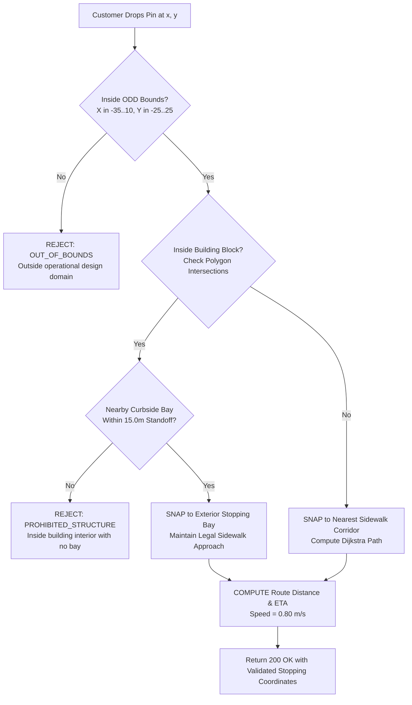

# NexusDelivery — Customer Destination & Interactive Map Integration

## 1. Overview & Operational Design Domain (ODD)

NexusDelivery operates in a Gazebo Classic 11 simulation environment (`small_city_dynamic.world`) representing an urban city center with asphalt roadways, concrete sidewalks, designated pedestrian crossings, curbside delivery bays, and multi-story commercial buildings.

The **Operational Design Domain (ODD)** is bounded within the metric Cartesian coordinate envelope:

$$\mathbf{ODD} = \left\{ (x, y) \in \mathbb{R}^2 \;\middle|\; -35.0 \le x \le 10.0\text{ m},\; -25.0 \le y \le 25.0\text{ m} \right\}$$

Within this envelope, autonomous rovers are restricted strictly to pedestrian sidewalks, crosswalk corridors, and designated stopping bays. Robots are physically and algorithmically prohibited from entering building interiors, private courtyards, or unapproved traffic segments.

---

## 2. Interactive Map Engine & Metric Coordinate System

The customer portal (`delivery_robot_sim/web_dashboard/client.html`) and supervisor cockpit (`supervisor.html`) utilize an HTML5 Canvas vector map engine (`gazebo_map.js`) that renders the Gazebo simulation world directly from architectural model geometry.

```
                  GAZEBO SIMULATION METRIC ENVELOPE
                      Y = +25.0m (North Boundary)
       +-----------------------------------------------+
       |             [ NORTH AVENUE SIDEWALK ]         |
       |  +--------------------+   +----------------+  |
       |  | North Block West   |   | North Block E. |  |
       |  | (Solid Building)   |   | (Solid Bldg)   |  |
       |  +--------------------+   +----------------+  |
       |                                               |
X=-35m | [CENTRAL DEPOT HUB]   ======== [CROSSWALK]   | X=+10m
(West) | (-31.5, -0.75)                                | (East)
       |                                               |
       |  +--------------------+   +----------------+  |
       |  | South Block West   |   | South Block E. |  |
       |  | (Solid Building)   |   | (Solid Bldg)   |  |
       |  +--------------------+   +----------------+  |
       |             [ SOUTH AVENUE SIDEWALK ]         |
       +-----------------------------------------------+
                      Y = -25.0m (South Boundary)
```

### Coordinate Transformations
1. **Screen Canvas to Gazebo Metric Space:**
   $$\begin{aligned}
   x_{\text{gazebo}} &= x_{\text{min}} + \frac{u}{\text{width}} \cdot (x_{\text{max}} - x_{\text{min}}) \\
   y_{\text{gazebo}} &= y_{\text{max}} - \frac{v}{\text{height}} \cdot (y_{\text{max}} - y_{\text{min}})
   \end{aligned}$$
2. **Gazebo Metric to GPS WGS-84 Projection:**
   $$\begin{aligned}
   \text{Latitude} &= 36.800500 + \frac{y_{\text{gazebo}}}{111139.0} \\
   \text{Longitude} &= 10.180000 + \frac{x_{\text{gazebo}}}{111139.0 \cdot \cos(\text{rad}(36.800500))}
   \end{aligned}$$
   *(Explicitly labeled in UI: `MATHEMATICAL_PROJECTION_FOR_DISPLAY_ONLY` to distinguish from non-existent physical GPS sensor)*.

---

## 3. Destination Reachability & Safety Validation Algorithm

When a customer drops or drags a pin on the interactive map, the backend validator (`validate_and_snap_destination(x, y)` in `delivery_robot_sim/route_planner.py`) runs a 4-stage safety evaluation:



### Stage 1: ODD Boundary Check
Points with $x < -35.0\text{ m}$, $x > 10.0\text{ m}$, $y < -25.0\text{ m}$, or $y > 25.0\text{ m}$ are immediately rejected with an explicit rejection explanation.

### Stage 2: Building Footprint Collision Filtering
The city model geometry contains 4 primary solid building structures:
- **North Building West:** $X \in [-28.0, -12.0]\text{ m}, Y \in [2.5, 12.0]\text{ m}$
- **North Building East:** $X \in [-8.0, 8.0]\text{ m}, Y \in [2.5, 12.0]\text{ m}$
- **South Building West:** $X \in [-28.0, -12.0]\text{ m}, Y \in [-12.0, -2.5]\text{ m}$
- **South Building East:** $X \in [-8.0, 8.0]\text{ m}, Y \in [-12.0, -2.5]\text{ m}$

If a customer clicks inside a solid building footprint, the system rejects the interior point and snaps the delivery target to the nearest exterior curbside bay on the adjacent sidewalk corridor.

### Stage 3: Curbside Delivery Bay Snapping
Standard legal curbside stopping bays with predetermined approach headings:
- **Bay 1 (North Avenue Curbside):** Target $(-9.80, 15.00)\text{ m}$, Stopping Bay $(-14.60, 15.00)\text{ m}$, Heading $0.00\text{ rad}$
- **Bay 2 (South Avenue Curbside):** Target $(-9.80, -15.00)\text{ m}$, Stopping Bay $(-14.60, -15.00)\text{ m}$, Heading $0.00\text{ rad}$
- **Central Logistics Depot Hub:** Docking Coordinate $(-31.50, -0.75)\text{ m}$, Heading $0.00\text{ rad}$

### Stage 4: Sidewalk Path Planning & ETA Computation
The route planner computes the shortest path along the sidewalk visibility graph. Route distance $D$ is calculated via Euclidean segment summation:

$$D = \sum_{i=1}^{n-1} \sqrt{(x_{i+1} - x_i)^2 + (y_{i+1} - y_i)^2}$$

Estimated transit duration $T_{\text{eta}}$ is derived using the safe sidewalk cruising speed ($v_{\text{cruise}} = 0.80\text{ m/s}$):

$$T_{\text{eta}} = \frac{D}{v_{\text{cruise}}} + t_{\text{docking}}$$

---

## 4. API Endpoints

### 1. `POST /api/destination/validate`
**Request:**
```json
{
  "x": -9.8,
  "y": 15.0,
  "customer_id": "USR-001"
}
```
**Response (Valid):**
```json
{
  "valid": true,
  "reachable": true,
  "raw_xy": [-9.8, 15.0],
  "stopping_xy": [-14.6, 15.0],
  "approach_heading": 0.0,
  "approach_heading_deg": 0.0,
  "explanation": "Curbside doorstep located on legal sidewalk corridor.",
  "route": [[-31.5, -0.75], [-31.5, 15.0], [-14.6, 15.0]],
  "distance_m": 32.76,
  "eta_seconds": 45,
  "eta_minutes": 1
}
```

**Response (Rejected):**
```json
{
  "valid": false,
  "reachable": false,
  "raw_xy": [150.0, 200.0],
  "explanation": "OUT_OF_BOUNDS",
  "message": "Destination (150.0, 200.0) rejected: Coordinate falls outside operational design domain boundaries. Prohibited area or no road access."
}
```

---

## 5. Supervisor Destination Reachability Inspector

In `delivery_robot_sim/web_dashboard/supervisor.html` and `supervisor.js`, supervisors have a dedicated **Destination Reachability & ODD Inspector** card:
- Allows operators to test arbitrary coordinate pairs $(X, Y)$.
- Validates the point in real-time against building polygons and sidewalk visibility corridors.
- Displays computed snapping coordinates, path distance, and safety clearance.
