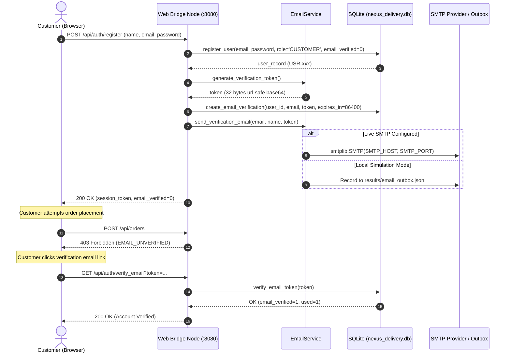

# NexusDelivery — Enterprise Email Verification Implementation

## 1. Architecture & Design Principles

The **NexusDelivery** email verification system provides cryptographically secure, production-grade identity verification for customers placing autonomous delivery orders.

Unverified customer accounts are strictly prevented from dispatching autonomous robots onto city sidewalks to prevent abuse, spam missions, and fraudulent address targets.



---

## 2. Configuration & Environment Variables

Credentials and runtime endpoints are never hardcoded in the codebase. Configuration is loaded dynamically from the environment with robust production defaults:

| Variable Name | Default Value | Description |
| :--- | :--- | :--- |
| `SMTP_HOST` | `""` (Empty string) | Fully qualified domain name or IP of the SMTP relay (e.g. `smtp.sendgrid.net`, `smtp.gmail.com`). |
| `SMTP_PORT` | `587` | Standard submission port (`587` for STARTTLS, `465` for SSL, `25` for internal relay). |
| `SMTP_USER` | `""` | SMTP authentication username or API key identifier. |
| `SMTP_PASS` | `""` | SMTP authentication password or secret API token. |
| `SMTP_FROM` | `no-reply@nexusdelivery.tn` | Authoritative RFC 5322 sender address displayed to customers. |
| `SMTP_USE_TLS`| `true` | When true, issues `STARTTLS` handshake before transmitting credentials. |
| `NEXUS_BASE_URL`| `http://localhost:8080` | Publicly reachable base URL used to construct verification hyperlinks. |
| `RESEND_COOLDOWN_SECONDS` | `60` | Duration of rate-limiting cooldown window per recipient address. |

---

## 3. Cryptographic Token Lifecycle & Database Schema

Verification tokens are generated using Python's cryptographically secure pseudo-random number generator (`secrets.token_urlsafe(32)`), producing 256 bits of entropy:

```python
import secrets
token = secrets.token_urlsafe(32)  # High-entropy URL-safe base64 string
```

### Database Schema (`email_verifications` table)
```sql
CREATE TABLE IF NOT EXISTS email_verifications (
    id INTEGER PRIMARY KEY AUTOINCREMENT,
    user_id TEXT NOT NULL,
    email TEXT NOT NULL,
    token TEXT NOT NULL UNIQUE,
    expires_at REAL NOT NULL,
    used INTEGER DEFAULT 0,  -- 0: Active, 1: Used/Verified, 2: Superseded/Revoked
    created_at REAL DEFAULT (strftime('%s', 'now')),
    FOREIGN KEY(user_id) REFERENCES users(id) ON DELETE CASCADE
);

CREATE INDEX IF NOT EXISTS idx_email_verif_token ON email_verifications(token);
CREATE INDEX IF NOT EXISTS idx_email_verif_user ON email_verifications(user_id);
```

### Token Verification Rules
1. **Single-Use Enforcement:** Once a token is presented and verified, `used` is set to `1`. Subsequent verification attempts with the same token fail with HTTP 400/410 `Invalid or unrecognized verification token`.
2. **Superseding Old Tokens:** When a new token is generated for a user, all existing unused tokens (`used = 0`) for that user are marked `used = 2` (superseded), preventing race conditions.
3. **Strict Expiration:** The backend verifies that `now < expires_at` (24-hour validity). Expired tokens are rejected with HTTP 410 `Verification link has expired`.

---

## 4. Rate Limiting Mechanism

To prevent mailbox bombing, credential stuffing, and SMTP relay abuse:
- The system enforces a **60-second cooldown per recipient email address**.
- Initial user registration sends the first verification email and immediately records the timestamp.
- Any call to `POST /api/auth/resend_verification` within 60 seconds of the previous send returns HTTP 429 Too Many Requests:

```json
{
  "success": false,
  "code": "RATE_LIMITED",
  "error": "Please wait 48 seconds before requesting a new verification email.",
  "retry_after_s": 48
}
```

The frontend displays an active countdown timer on the resend button: `Wait 48s`.

---

## 5. Transparent Outbox Fallback (Offline & Simulation Mode)

When live SMTP credentials are not present in the environment (e.g. offline testing, Gazebo dynamic simulation sandbox), `EmailService` automatically logs emails to `results/email_outbox.json`:

```json
[
  {
    "to": "customer_1793734010@nexus.tn",
    "name": "Nadia Ben Ammar",
    "token": "5omQNSEqt5RK5tGFf6AzMY5GHkJd707quATUoEikUvY",
    "verify_url": "http://localhost:8080/client?verify_token=5omQNSEqt5RK5tGFf6AzMY5GHkJd707quATUoEikUvY",
    "api_verify_url": "http://localhost:8080/api/auth/verify_email?token=5omQNSEqt5RK5tGFf6AzMY5GHkJd707quATUoEikUvY",
    "timestamp": 1793734010.586,
    "status": "SAVED_TO_OUTBOX_DEV_MODE"
  }
]
```

Development and automated integration tests can inspect this outbox via `GET /api/outbox` without simulating or faking email transmission.

---

## 6. Frontend Customer Portal Integration

The customer portal (`delivery_robot_sim/web_dashboard/client.html`, `client.js`, `client.css`) integrates verification at every step:

1. **Top Alert Banner:** Appears automatically when `currentUser.email_verified === 0`. Displays customer email and provides an interactive "Resend Verification Email" button with real-time feedback.
2. **Account Modal:** Clicking the customer avatar in the navigation bar opens the Customer Account & Profile modal. It displays an email verification badge (`✓ Email Verified` in emerald green vs `⚠️ Unverified` in amber) alongside tenant order history.
3. **Cart & Checkout Gate:** Clicking "Confirm & Dispatch Autonomous Rover" checks verification status. If unverified, the order is blocked with audio alert and visual toast notification:
   > *⚠️ Email verification required! Please verify your email before placing orders.*
4. **Email Link Handler:** When a customer clicks the link in their email (`/client?verify_token=...`), the page automatically verifies the token via API, displays a success toast, updates the local user object, and removes the token from the browser history via `history.replaceState`.
