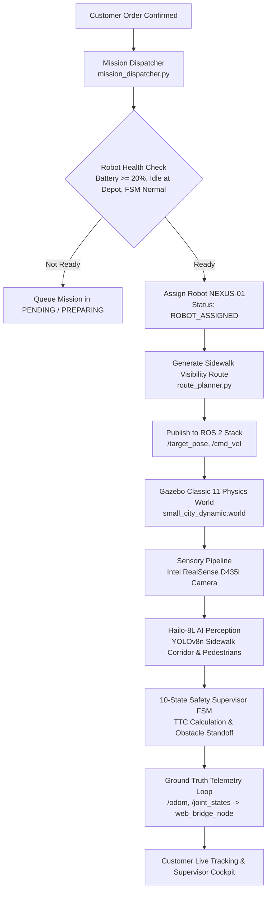

# NexusDelivery — Robot Dispatch & Autonomous Navigation Integration

## 1. System Integration Architecture

NexusDelivery integrates customer order management with the existing ROS 2 Humble robotics stack and Gazebo Classic 11 physical simulator:



---

## 2. Zero-LiDAR, Zero-GPS Vision-Led Autonomy Pipeline

In strict compliance with project architecture specifications:
- **Zero LiDAR:** No 2D or 3D LiDAR sensors exist on the chassis or in the sensor processing pipeline.
- **Zero GPS:** No physical GPS/GNSS receiver is mounted on the robot. Sidewalk localization is accomplished through visual-inertial odometry, wheel encoder odometry, and known metric feature geometry.
- **Primary Sensors:**
  1. **Intel RealSense D435i Depth Camera:** Active IR stereo depth + RGB stream ($640 \times 480$ @ 30 FPS, $87^\circ \times 58^\circ$ FOV).
  2. **Hailo-8L M.2 NPU Accelerator:** Hardware neural processing unit executing YOLOv8n object detection at 13.0 TOPS (7.18 ms latency, 138.4 FPS benchmark).
  3. **Dual ODrive S1 CAN 2.0B Motor Controllers:** High-resolution optical encoders on direct-drive brushless DC hub motors providing wheel velocity and travel feedback.
  4. **BMS 8-Cell LiFePO4 Monitor:** Real-time 25.6V pack voltage, current draw, and cell balance telemetry.

---

## 3. Robot Dispatch Decision & Allocation Engine

When an order reaches `READY_FOR_DISPATCH`, the mission dispatcher (`mission_dispatcher.py`) runs the robot assignment check:

1. **Mission State Check:** Robot must be in `IDLE_AT_DEPOT` or `NORMAL_OPERATION` docked at Central Logistics Depot (`-31.50, -0.75`).
2. **Battery State of Charge (SoC):** Pack voltage must be $\ge 24.0\text{ V}$ ($\ge 20\%$ capacity). If below threshold, AMR remains on charger.
3. **Cargo Capacity & Availability:** Cargo compartment must be unloaded (`package_loaded == False`), motorized hatch locked (`0.0^\circ`), and lift lowered.
4. **Safety FSM Diagnostics:** 10-state safety supervisor must be in `NORMAL_OPERATION` with no active hardware E-Stop or CAN bus faults.

Once allocated, the dispatcher transitions the order to `ROBOT_ASSIGNED` and immediately advances to `ROBOT_EN_ROUTE` upon acknowledging the ROS 2 navigation goal.

---

## 4. Ground-Truth Telemetry vs Simulated Telemetry

NexusDelivery strictly distinguishes actual Gazebo runtime physics from software placeholders:

| Telemetry State | Odometry Freshness ($t_{\text{now}} - t_{\text{odom}}$) | Data Provenance | UI Badge & Color | Velocity Display |
| :--- | :--- | :--- | :--- | :--- |
| **`LIVE_GAZEBO_TELEMETRY`** | $< 2.0\text{ seconds}$ | Real-time Gazebo model pose from `/odom`. Ground truth physics. | `● LIVE GAZEBO (GROUND TRUTH)` (Emerald Green) | Actual physical velocity from encoders ($\pm 0.80\text{ m/s}$). |
| **`LAST_KNOWN_POSITION`** | $2.0\text{ s} \le t \le 15.0\text{ seconds}$ | Simulation paused or slow tick rate. Displays cached position. | `▲ LAST KNOWN POSITION (CACHED)` (Amber Yellow) | Clamped to $0.00\text{ m/s}$ (no fabricated motion). |
| **`UNAVAILABLE_SIMULATION_OFFLINE`** | $> 15.0\text{ seconds}$ (or connection dead) | Gazebo offline or ROS 2 node unreachable. | `✖ TELEMETRY UNAVAILABLE (SIM OFFLINE)` (Ruby Red) | Clamped to $0.00\text{ m/s}$. ETA set to null/Standby. |

An HTTP 200 response from `/api/orders` merely acknowledges database persistence; **a robot is never reported as dispatched or in motion unless verified telemetry confirms active waypoint progress.**

---

## 5. Dynamic Obstacle Avoidance & Sidewalk Replanning

During sidewalk transit, the AI YOLO node and safety supervisor monitor the ground plane corridor:

```
                          Ground Plane Corridor (2.4m Width)
         +-------------------------------------------------------+
         |                                                       |
AMR ---> |   [ROBOT] ========== (CLEAR PATH) ==========> [WAYPOINT]
         |                                                       |
         +-------------------------------------------------------+

                     corridor blocked: Pedestrian at 2.1m
         +-------------------------------------------------------+
         |                   [ PEDESTRIAN ]                      |
AMR ---> |   [ROBOT] ---> (DECEL)            (REPLAN AROUND)     |
         |                   \_________________________________/ |
         +-------------------------------------------------------+
```

1. **Corridor Clear ($\text{TTC} > 5.0\text{ s}$):** AMR maintains legal sidewalk speed ($0.80\text{ m/s}$).
2. **Dynamic Obstacle / Pedestrian Detected ($\text{TTC} \le 5.0\text{ s}$, distance $1.5\text{ m} \le d \le 3.5\text{ m}$):** Safety FSM transitions to `DECELERATING`. Path planner attempts lateral sidewalk corridor detour.
3. **Critical Standoff ($d < 1.0\text{ m}$):** Chassis performs emergency controlled stop (`STOPPED_OBSTACLE`).
4. **Total Corridor Blockage:** If static blockage persists for $> 30\text{ seconds}$ and no legal sidewalk bypass exists, order transitions to `UNREACHABLE`. AMR safely halts and notifies fleet supervisor.

---

## 6. Curbside Arrival Detection & Safe Standstill

Arrival detection is governed by strict metric proximity to the pre-validated stopping bay:

$$d_{\text{target}} = \sqrt{(x_{\text{amr}} - x_{\text{bay}})^2 + (y_{\text{amr}} - y_{\text{bay}})^2} \le 0.10\text{ m}$$

When $d_{\text{target}} \le 0.10\text{ m}$:
1. Motor commands ramp to zero ($\mathbf{v} = 0.00\text{ m/s}$, $\mathbf{\omega} = 0.00\text{ rad/s}$).
2. Order status transitions from `ROBOT_EN_ROUTE` to `ROBOT_ARRIVED`.
3. Customer receives arrival push notification and audio chime on tracking portal.
4. Robot safely holds position awaiting customer 6-digit OTP verification.
