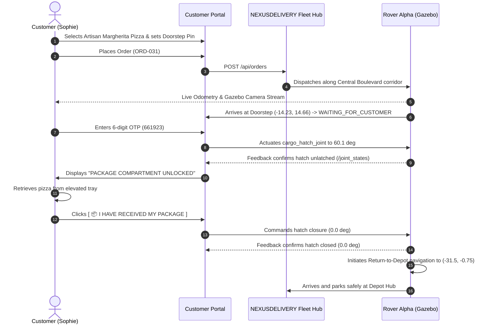

# NEXUSDELIVERY Final Customer Experience & Product Report

## 1. Product Vision & Commercial Standard
NEXUSDELIVERY delivers a high-end autonomous sidewalk delivery service comparable to Tier-1 delivery tech platforms. The customer web experience (`http://localhost:8080/client`) is designed around 4 core principles:
1. **Uncompromised Visual Contrast:** Clean light mode default with deep slate typography (`#0f172a`), eliminating text washout and unreadable sections.
2. **Authentic Product Identity:** High-resolution culinary photography representing actual temperature-managed deliveries.
3. **Interactive Sidewalk Pinning:** Direct spatial selection of doorstep delivery bays on the living Gazebo vector map.
4. **Frictionless Security:** A two-step physical handover sequence ensuring parcels are collected before the robot departs.

---

## 2. Customer Interaction Flow

---

## 3. Customer UI Highlights & Usability Details
- **Navigation:** Quick-access links `HOME | MENU | EXPLORE MAP | MY ORDERS | LIVE TRACKING | CART | ACCOUNT`.
- **Live Video Feed:** Real-time stream of the robot's front RGB-D camera as it navigates urban sidewalks.
- **Auditory Feedback:** Professional, subtle audio chimes on click, order dispatch, and handover completion.
- **Account Dashboard:** Direct access to order receipts, verification status, and saved doorstep coordinates.
