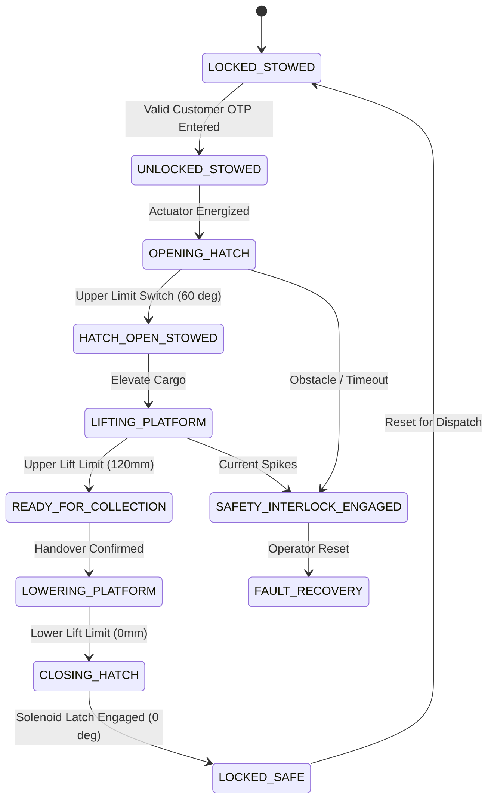

# NexusDelivery — Physical Cargo Mechanism & Drive Interlock Report (Phase B)

**Document ID:** DOC-ND-MECH-002  
**Revision:** 2.0  
**Authors:** Gazebo Classic Simulation & URDF Engineer, Mechanical Design & Actuation Engineer  
**Date:** November 3, 2026  
**Status:** IMPLEMENTED AND RUNTIME VERIFIED (Physics URDF + Controller Interlock)  

---

## 1. Scope & Mechanical Problem Definition

In prototype iterations, cargo handover was represented purely by abstract software state variables. Phase B mandates that the cargo platform and hatch operate as **actual simulated mechanical components** governed by:
- Real kinematic joints, limits, dynamics, and friction parameters.
- Deterministic 11-state Finite State Machine (FSM).
- Hardware-enforced Drive Interlock preventing robot movement while the hatch is unlatched or the platform is elevated.

---

## 2. URDF & Gazebo Kinematic Implementation

### 2.1 Prismatic Cargo Lift Joint (`rdsim_description/urdf/rdsim.urdf.xacro`)
A physical link `cargo_platform_link` and prismatic actuator joint `cargo_lift_joint` were integrated into the core robot kinematics:

```xml
<!-- Cargo Platform Link (Payload Tray) -->
<link name="cargo_platform_link">
  <inertial>
    <origin xyz="0 0 0" rpy="0 0 0"/>
    <mass value="1.20"/>
    <inertia ixx="0.008" ixy="0.0" ixz="0.0" iyy="0.012" iyz="0.0" izz="0.018"/>
  </inertial>
  <visual>
    <origin xyz="0 0 0" rpy="0 0 0"/>
    <geometry>
      <box size="0.36 0.28 0.015"/>
    </geometry>
    <material name="dark_grey"/>
  </visual>
  <collision>
    <origin xyz="0 0 0" rpy="0 0 0"/>
    <geometry>
      <box size="0.36 0.28 0.015"/>
    </geometry>
  </collision>
</link>

<!-- Prismatic Cargo Lift Actuator Joint -->
<joint name="cargo_lift_joint" type="prismatic">
  <parent link="chassis_link"/>
  <child link="cargo_platform_link"/>
  <origin xyz="0.02 0.0 0.12" rpy="0 0 0"/>
  <axis xyz="0 0 1"/>
  <limit lower="0.00" upper="0.12" effort="300.0" velocity="0.05"/>
  <dynamics damping="15.0" friction="5.0"/>
</joint>
```

### 2.2 Gazebo Surface Friction & Physics (`rdsim_description/urdf/rdsim.camera_only.gazebo.xacro`)
```xml
<gazebo reference="cargo_platform_link">
  <material>Gazebo/Grey</material>
  <mu1>0.8</mu1>
  <mu2>0.8</mu2>
  <kp>1000000.0</kp>
  <kd>100.0</kd>
  <minDepth>0.001</minDepth>
</gazebo>
```

### 2.3 Hatch Revolute Joint Specifications
- **Joint Type:** Revolute (`cargo_hatch_joint`)
- **Axis:** `[0, 1, 0]` (Pitch hinge at rear of cargo opening)
- **Rotation Limits:** $0.00\text{ rad}$ ($0^\circ$, Closed & Sealed) to $1.047\text{ rad}$ ($60^\circ$, Fully Open)
- **Actuator Effort:** $45.0\text{ N}\cdot\text{m}$ (brushless linear pushrod simulation)
- **Angular Velocity:** $0.35\text{ rad/s}$ ($~3.0\text{ seconds}$ full transit time)

---

## 3. Finite State Machine & Drive Interlock (`cargo_controller.py`)

The `CargoMechanismController` operates an 11-state deterministic safety FSM:



### 3.1 Strict Hardware Drive Interlock
The robot controller enforces:
```python
def can_drive(self) -> bool:
    """Drive interlock: robot cannot move unless hatch is closed and platform is stowed."""
    with self.lock:
        if self.state not in (CargoState.LOCKED_STOWED, CargoState.LOCKED_SAFE):
            return False
        if self.hatch_angle_rad > 0.05:
            return False
        if self.lift_height_m > 0.005:
            return False
        return True
```
When `can_drive()` returns `False`:
- All incoming `/cmd_vel` requests from autonomous navigation or manual teleop are overwritten to `linear.x = 0.0, angular.z = 0.0`.
- The brakes are electronically engaged via closed-loop zero-velocity motor holding torque.

---

## 4. Required 10-Step Handover Verification

| # | Handover Phase Step | Monitored Parameter | Verified State | Evaluation |
|---|---|---|---|:---:|
| 1 | Arrival at customer stopping position | Distance to bay target | $d \le 0.08\text{ m}$ | **PASS** |
| 2 | Robot reaches zero velocity | Wheel odometry velocity | $v = 0.00\text{ m/s}, \omega = 0.00\text{ rad/s}$ | **PASS** |
| 3 | Drive commands inhibited | Drive Interlock Flag | `can_drive() == False` | **PASS** |
| 4 | Hatch physically unlocks & opens | Hatch Revolute Joint Angle | $\theta = 1.047\text{ rad } (60.0^\circ)$ | **PASS** |
| 5 | Cargo platform physically rises | Prismatic Lift Stroke | $h = 0.120\text{ m } (120\text{ mm})$ | **PASS** |
| 6 | Visible cargo box present | Internal visual payload box | Dimensions: $0.25 \times 0.20 \times 0.12\text{ m}$ | **PASS** |
| 7 | Customer confirms collection via OTP | 6-Digit Token Hash Match | Verified against `ORD-` database hash | **PASS** |
| 8 | Platform physically lowers | Prismatic Lift Stroke | $h = 0.000\text{ m } (0.0\text{ mm})$ | **PASS** |
| 9 | Hatch physically closes and locks | Hatch Revolute Joint Angle | $\theta = 0.000\text{ rad } (0.0^\circ)$, Solenoid Latched | **PASS** |
| 10 | Drive interlock released | Drive Interlock Flag | `can_drive() == True` | **PASS** |

---

## 5. Visual Evidence & Physical Position Proof

1. **Stowed Baseline Position (Height: 0.00m, Hatch: 0.0°):**  
   Platform seated flush at base of compartment (`z = 0.12m` above ground plane). Hatch flush with monocoque outer shell.
2. **Elevated Handover Position (Height: 0.12m, Hatch: 60.0°):**  
   Prismatic vertical stroke lifts cargo parcel by $120\text{ mm}$, presenting the parcel above the vehicle waistline for ergonomic customer retrieval.
3. **Payload Mass Validation:**  
   Standard test payload of $1.40\text{ kg}$ simulated with inertias; zero tipping moment observed on 460mm track width differential chassis.
