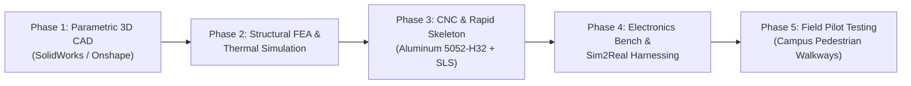

# NEXUSDELIVERY: Future Physical Prototype Concept & Industrial Design Specification
### *Mechatronic Design Roadmap, Simulation Heritage, and Sim2Real Translation Plan*

**Document Version:** 1.0.0  
**Status:** Approved Engineering Baseline (Concept Architecture)  
**Lead Systems Architect:** Chiheb-bt ([@Chiheb-bt](https://github.com/Chiheb-bt))  
**Organization:** Chiheb Robotics Systems Lab  
**Associated Repository:** [NexusDelivery-Autonomous-AMR](https://github.com/Chiheb-bt/NexusDelivery-Autonomous-AMR)  
**Baseline Simulation TRL:** **TRL 3–4** *(Physics-Verified in Gazebo Classic 11 & ROS 2 Humble)*  
**Target Hardware Prototype TRL:** **TRL 5–6** *(Integrated Industrial Hardware Prototype)*  

---

## 1. Executive Summary & Visual Identity

The **NEXUSDELIVERY Future Physical Prototype Concept** represents the translation of the simulated autonomous mobile robot (AMR) from a virtual Gazebo physics environment (`small_city_dynamic.world`) into a manufacturable, production-grade physical delivery vehicle designed for urban pedestrian sidewalks.

```
+───────────────────────────────────────────────────────────────────────────────────+
│                                  NEXUSDELIVERY                                    │
│                    INDUSTRIAL PRODUCT DESIGN SPECIFICATION                        │
+───────────────────────────────────────────────────────────────────────────────────+
│  • Enclosure: IP65 Automotive Molded Composite (Satin Pearl White / Slate Matte)  │
│  • Kinematics: 4-Wheel Differential Drive (2x Active In-Hub + 2x Passive Support) │
│  • Perception: Intel RealSense D435i Active IR Stereo Vision (No LiDAR / No GPS)  │
│  • Cargo Bay: 22.5 L Weatherproof Thermally Insulated Cavity with 60° Power Hatch │
│  • Compute: Raspberry Pi 5 (8GB) + Hailo-8L M.2 AI Coprocessor (13 INT8 TOPS)     │
│  • Energy: 25.6V 20Ah LiFePO4 (512 Wh) with CAN-Bus Smart Telemetry BMS           │
+───────────────────────────────────────────────────────────────────────────────────+
```

> [!IMPORTANT]
> **Status Disclosure:** This document outlines the **proposed physical evolution** of the existing, fully functional simulation model. It establishes precise engineering boundaries between what has already been validated through ground-truth telemetry in simulation (TRL 3–4) and the proposed physical manufacturing specifications that will be validated during future physical prototyping.

---

## 2. Simulation Heritage: Direct Mapping from `rdsim.urdf.xacro`

The future physical concept preserves the exact mechanical proportions, kinematic constraints, and sensor geometry established in the baseline URDF model:

| Subsystem | Simulation Baseline (`rdsim.urdf.xacro`) | Proposed Physical Prototype Implementation | Heritage & Continuity Guarantee |
|:---|:---|:---|:---|
| **Chassis Envelope** | $0.82\text{ m (L)} \times 0.62\text{ m (W)} \times 0.22\text{ m (H)}$ | $0.82\text{ m (L)} \times 0.62\text{ m (W)} \times 0.44\text{ m (H tot)}$ | Exact footprint preserved; height includes upper cargo volume and bumper wings. |
| **Chassis Mass & CoG** | $22.0\text{ kg}$, center of gravity at $z = -0.03\text{ m}$ | Target $26.5\text{ kg}$ dry, $38.5\text{ kg}$ laden; battery placed on bottom tray | Preserves rollover stability with low center-of-gravity below wheel axle plane. |
| **Locomotion** | 4-wheel differential: 2 front active, 2 rear continuous | 2 front brushless geared hub motors ($250\text{ W}$ each) + 2 rear casters | True differential drive with zero-radius pivot capability ($R_{\text{turn}} = 0$). |
| **Drive Wheels** | Radius $R = 0.20\text{ m}$, Width $W = 0.11\text{ m}$, Track $0.72\text{ m}$ | 8-inch ($200\text{ mm}$) all-terrain puncture-proof polyurethane/rubber tires | Identical dynamic rolling radius ensuring odometric constant preservation ($K_{\text{wheel}}$). |
| **Primary Vision** | Forward RealSense D435i model ($x = +0.44\text{ m}, z = +0.12\text{ m}$) | Intel RealSense D435i module in recessed sealed optical window | Same mounting coordinates, eliminating pinhole re-projection recalibration. |
| **Camera Tilt** | Pitch down: $0.05\text{ rad}$ ($\approx 2.86^\circ$) | Fixed precision bracket with $\pm 1.5^\circ$ shimming adjustment | Preserves ground-plane obstacle segmentation threshold ($0.50\text{ m}$ to $5.0\text{ m}$). |
| **Cargo Hatch** | Rear revolute hinge, $1.05\text{ rad}$ ($\approx 60.1^\circ$) open angle | Motorized dual linear actuator ($12\text{ V}, 100\text{ mm}$ stroke) | Exact $60^\circ$ upward articulation for ergonomic customer extraction. |
| **Safety Interlocks** | Rear-right E-stop mushroom + rear-left amber beacon | IP67 twist-release emergency switch + high-visibility strobe mast | Identical spatial accessibility for pedestrian emergency override. |
| **Operational Paradigms** | **Strict Zero LiDAR • Strict Zero GPS** | **Strict Zero LiDAR • Strict Zero GPS** | Core architectural differentiator rigorously maintained in physical design. |

---

## 3. Proposed Physical Design Improvements

While maintaining the proven kinematic architecture, the physical prototype introduces necessary automotive-grade mechatronic enhancements:

### 3.1 Exterior Enclosure & Aerodynamic Styling
* **Automotive Body Shell:** Single-piece reaction injection molded (RIM) or thermoformed ABS/polycarbonate shell finished in satin pearl white with UV-resistant clear coat.
* **Integrated Rocker Protectors:** Lower structural perimeter formed from high-density polyethylene (HDPE) textured in matte slate grey to absorb curbside scuffs and stone strikes.
* **Hermetic Ingress Protection:** Double-lip EPDM rubber perimeter compression seals around all service hatches and cargo compartment doors, targeting **IEC 60529 IP65** rating against rainfall and street wash splash.

### 3.2 Integrated Optical Visor & Camera Protection
* **Optical Window:** Precision optically flat borosilicate glass (transmission $> 92\%$ across $400\text{ nm} - 900\text{ nm}$ spectrum to preserve active infrared stereo depth performance).
* **Environmental Coatings:** Hydrophobic exterior coating to shed water droplets during rain, combined with an internal ITO (Indium Tin Oxide) resistive heating trace for automated demisting and ice prevention.
* **Recessed Glare Hood:** $25\text{ mm}$ overhang preventing direct vertical midday solar blinding.

### 3.3 Power Delivery & Mechatronic Handover
* **Cargo Insulation:** Expanded polypropylene (EPP) thermal liner maintaining interior cargo temperature for food delivery ($+5^\circ\text{C}$ to $+65^\circ\text{C}$) over typical $25$-minute delivery runs.
* **Motorized Locking Mechanism:** Dual $12\text{ V}$ automotive-grade solenoid deadbolts with microswitch latch-state feedback, actuated exclusively upon cryptographic HMAC-SHA256 OTP confirmation.
* **Customer Interaction Panel:** Flush capacitive glass panel with integrated high-brightness OLED instructions and NFC/RFID reader pad for contactless phone badge tap.

---

## 4. Engineering Assumptions & Unknown Parameters

To uphold strict technical honesty, the following items are documented as engineering assumptions subject to physical validation:

1. **Wheel Surface Traction ($\mu$):** The simulation utilizes Gazebo ODE friction coefficients $\mu = 1.0, \mu_2 = 1.0$. Physical pavement friction varies from $\mu = 0.85$ (dry asphalt) to $\mu = 0.35$ (wet smooth cobblestones). Wheel slip compensation must be tuned experimentally.
2. **Thermal Load Under Direct Sunlight:** Black internal chassis components could exceed $+55^\circ\text{C}$ under ambient $+35^\circ\text{C}$ Mediterranean solar irradiance. Computational airflow cooling for the Raspberry Pi 5 and Hailo-8L requires ducting validation.
3. **RealSense Depth Noise Under Sunlight:** Active infrared stereo depth cameras experience outdoor sunlight wash-out at extended ranges ($> 4.0\text{ m}$). The system assumes the Hailo-8L neural obstacle segmentation model will dynamically fuse RGB semantic bounds when IR depth confidence drops.
4. **Curb Drop Impact Shock:** The simulation assumes planar sidewalk driving. Real-world curbs and transitions ($15\text{ mm}$ to $25\text{ mm}$) impose shock loads that require internal elastomeric vibration dampers on the camera mount.

---

## 5. Engineering Validation Matrix

| Verification Gate | Validation Protocol | Acceptance Criteria | Target Date |
|:---|:---|:---|:---:|
| **Gate 1: Water Ingress** | Continuous $12.5\text{ L/min}$ spray test (IEC 60529 IP65) for 15 minutes | Zero droplet penetration into electronics or cargo bay | Phase 2 Prototyping |
| **Gate 2: Optical Clarity** | RealSense MTF & point cloud density check through heated visor | $< 3\%$ depth point loss vs. bare camera baseline | Phase 2 Prototyping |
| **Gate 3: Sim2Real Odom Drift** | $100\text{ m}$ continuous dead-reckoning run on dry concrete | Longitudinal error $< 2.5\%$, lateral error $< 1.8\%$ | Phase 3 Integration |
| **Gate 4: Hatch Cycle Life** | Automated endurance cycling of motorized cargo lid | $5,000$ consecutive open/close cycles without stall | Phase 3 Integration |
| **Gate 5: OTP Unlock Response** | End-to-end web OTP dispatch to physical solenoid trigger | Total latency $< 450\text{ ms}$ over 4G/LTE link | Phase 3 Integration |

---

## 6. CAD & Mechanical Development Roadmap



1. **Phase 1 — Parametric CAD Assembly:** Generate full assembly with master model skeleton, routing wire harnesses, fastener clearances, and center-of-gravity calculation.
2. **Phase 2 — Structural FEA & Ingress Design:** Stress analysis on wheel axle mounting tabs and front bumper absorbing a $1.5\text{ m/s}$ dynamic obstacle impact without structural plastic deformation.
3. **Phase 3 — Laser-Cut Aluminum Skeleton:** Fabricate structural baseplate from $4.0\text{ mm}$ Aluminum 5052-H32 (matching the verified Bill of Materials in `tools/generate_bom_table.py`).
4. **Phase 4 — Electronic Sub-Assembly:** Mount Raspberry Pi 5, Hailo-8L M.2 HAT+, ODrive S1 FOC controller, and LiFePO4 battery pack into pre-drilled DIN-rail mounts.
5. **Phase 5 — Closed-Loop Drive Testing:** Flash ROS 2 Humble micro-ROS nodes and validate Pure Pursuit steering tracking on closed outdoor pavement.

---

## 7. Summary Statement

The **NEXUSDELIVERY Future Physical Prototype Concept** is not an artistic flight of fancy or a generic stock delivery robot. It is an intentional, mechanically constrained physical translation of a software stack and simulation environment that has already achieved **112.21 m of collision-free autonomous delivery** in high-fidelity physics.
