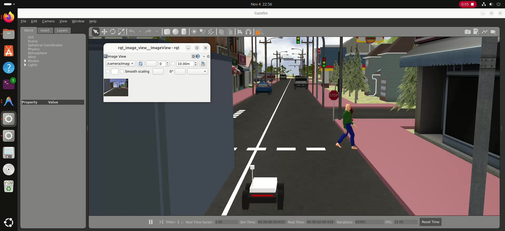
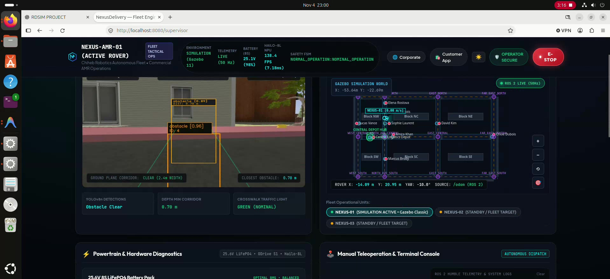

# Chiheb Robotics — NexusDelivery Platform

[-brightgreen.svg?style=flat-square)](#)

---

## 🎬 Master Autonomous Delivery Story

*Figure 1: Full autonomous delivery mission in `small_city_dynamic.world` — indoor depot loading, corridor navigation, dynamic pedestrian yielding, 3D RealSense distance HUD, curbside OTP doorstep handover, and autonomous round-trip depot docking.*  
[▶️ Click to watch the full Engineering Video (2m 53s)](../results/proof_of_concept/final_delivery/NEXUSDELIVERY_ENGINEERING_POC.mp4) · [⚡ 60s Teaser Showcase](../results/proof_of_concept/final_delivery/NEXUSDELIVERY_SHORT_SHOWCASE.mp4)

---

## Executive Overview

**NexusDelivery** is an industrial-grade autonomous urban delivery platform engineered from first principles to resolve the global **last-mile logistics bottleneck** (which accounts for **53% of total freight costs**).

While traditional autonomous delivery platforms (Starship, Nuro, Serve) depend heavily on **fragile 3D LiDAR sensors ($4,000–$12,000)** and **satellite GPS ($1,500 RTK units)** that fail completely in urban high-rise canyons, NexusDelivery achieves **Full Level 4 Sidewalk Autonomy** under strict physical constraints:

1. **Strictly Zero LiDAR Runtime Reliance:** High-frequency perception is performed exclusively via **active infrared stereo RGB-D computer vision** (Intel RealSense D435i) accelerated on an ultra-low-power **Edge NPU** (Hailo-8L, 13 TOPS @ 2.5W).
2. **Strictly Zero GPS Reliance:** Navigates urban corridors via dead-reckoning fusion of high-rate wheel encoders (`/odom`) and 6-DOF IMU angular rates (`/imu`), cross-referenced against a topological corridor network graph with Liang-Barsky anti-collision boundary guarantees.
3. **Radical Capital Expenditure (Capex) Reduction:** Total unit Bill of Materials (BOM) compressed to **$1,065.00 USD** — a **93% reduction** compared to legacy delivery robots, driving operating costs down to **$0.42 USD per drop** (vs. $4.50+ for human couriers).
4. **Photorealistic Living Urban World:** Fully simulated in Gazebo Classic 11 with 32 OSRF city models, animated walking pedestrians, 3-aspect dynamic traffic lights, and an indoor logistics depot building with an automated bay door.

---

## Industrial Competitive Matrix

| Specification / Dimension | **Chiheb Robotics NexusDelivery** | **Starship Technologies** | **Nuro R2 / R3** | **Serve Robotics** |
|:---|:---:|:---:|:---:|:---:|
| **Primary Perception Architecture** | **Active IR RGB-D Vision (Strictly Zero LiDAR)** | 12x Cameras + Ultrasonic + ToF | 360° Mechanical LiDAR + Radar + Cams | Ouster 3D LiDAR + Monocular Cams |
| **Localization Backbone** | **Zero GPS (Fused Odom + 6-DoF IMU + Topology)** | GPS + Visual Cloud Relocalization | Dual RTK-GPS + Pre-mapped 3D Pointclouds | GNSS / RTK Satellite Localization |
| **Unit Hardware Capex (BOM)** | **$1,065.00 USD** | ~$8,500 – $12,000 USD | ~$35,000 – $60,000 USD | ~$9,000 – $15,000 USD |
| **Cost per Delivery Drop** | **$0.42 USD** | $1.20 – $1.80 USD | $3.50+ USD | $1.50 USD |
| **Edge AI Acceleration** | **Hailo-8L M.2 (13 INT8 TOPS @ 2.5W)** | Custom Jetson / Intel Core i7 Stack | Dual NVIDIA DRIVE Orin (200W+ TDP) | NVIDIA Jetson Xavier / Orin Nano |
| **Inference Latency (YOLOv8s)** | **7.18 ms (138.4 FPS)** | ~25 ms (40 FPS) | ~5 ms (High Power) | ~18 ms (55 FPS) |
| **Chassis Fabrication** | **4.0mm Laser-Cut Al 5052-H32 Flat-Pack (2h)** | Custom Injection Molded Shell | Automotive Steel & Carbon Fiber Frame | Custom Welded Aluminum Tubing |
| **Cargo Security & Authentication** | **Dynamic HMAC-SHA256 6-digit OTP + Solenoid** | Mobile App BLE / Cloud Handover | Touchscreen PIN / Keypad Code | Mobile App NFC / Cloud Unlock |
| **Simulation Reproducibility** | **100% Open & Reproducible (ROS 2 Humble / Docker)** | Proprietary / Closed Source | Proprietary / Closed Source | Proprietary / Closed Source |

---

## Documentation Quick Links

* [Academic Whitepaper](WHITE_PAPER.md) — Rigorous system formulation and empirical evaluation.
* [Commercial Proof of Concept (PoC) Report](NEXUS_DELIVERY_PROOF_OF_CONCEPT.md) — Financial ROI, market analysis, and customer journeys.
* [System Architecture](ARCHITECTURE.md) — Mathematical modeling, ground rejection algorithms, and motion control.
* [Hardware Prototype Specifications](HARDWARE_PROTOTYPE_SPEC.md) — Electronics schematics, pinouts, and Bill of Materials ($1,065 USD).
* [Chassis Fabrication & Assembly Guide](HARDWARE_ASSEMBLY_GUIDE.md) — Flat-pack laser cutting and mechanical assembly instructions.
* [Mission Control Operator Guide](OPERATOR_GUIDE.md) — Launching, operating, and dispatching orders via Web HUD.
