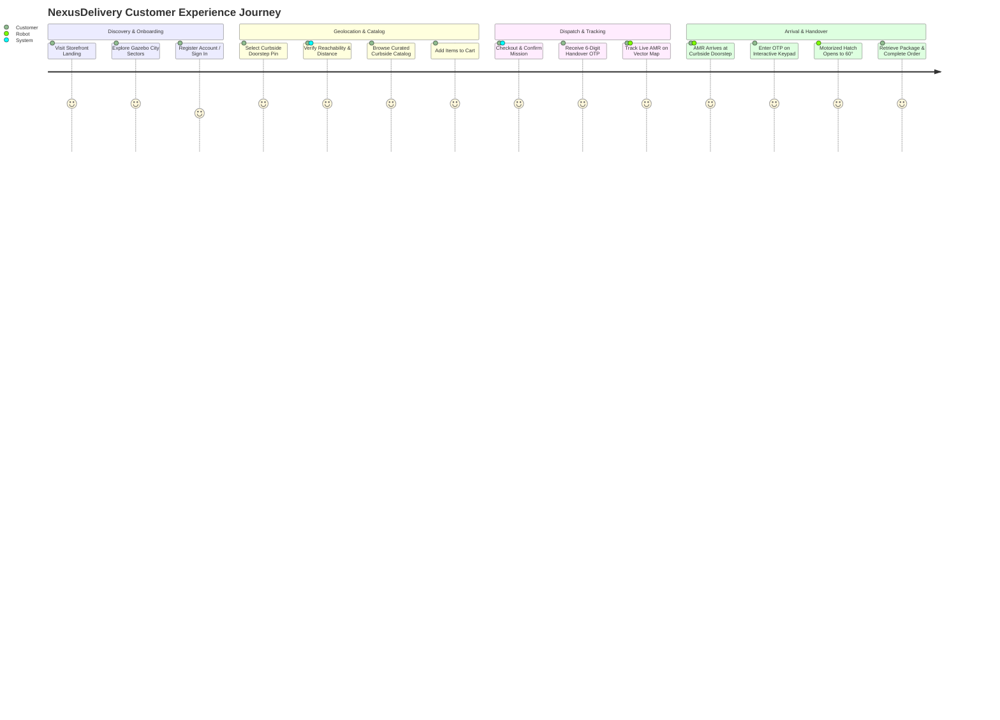

# NexusDelivery — Customer Experience Journey & UX Architecture
## End-to-End Autonomous Curbside Delivery Workflow, Doorstep Geolocation & Contactless Secure Handover

**Document Version:** 2.0.0  
**Target Users:** Residential & Commercial Customers in Autonomous Service Sectors  
**Platform:** Responsive Web Application (Desktop, Tablet, Mobile)  
**Primary Interface:** Native HTML5 2D Vector Map of Operational Gazebo Environment

---

## 1. Product Vision & UX Principles

The NexusDelivery Customer Platform delivers a frictionless, transparent, and delighting delivery experience inspired by top consumer apps (e.g. Uber Eats, Deliveroo), while preserving rigorous engineering truth. 

### Core UX Tenets:
1. **Absolute Honesty:** Every displayed metric (speed, distance, ETA, robot location) reflects real simulation or hardware telemetry. We never synthesize movement or display artificial tracking animations.
2. **Visual Clarity:** Dark Obsidian aesthetic (`#07090e`) with electric cyan (`#00f0ff`) and emerald (`#10b981`) telemetry accents, responsive typography (`Outfit` and `Plus Jakarta Sans`), and tactile Web Audio chimes.
3. **Curbside Safety First:** Customers cannot place pins inside buildings, across active vehicular roadways, or in inaccessible zones. The system validates reachability before allowing checkout.

---

## 2. Comprehensive 8-Stage Customer Journey

---

### Stage 1: Storefront Landing & Service Overview
- **Visual Presentation:** Premium hero section highlighting the autonomous zero-emission delivery mission. Live status indicator displays system mode: `SIMULATION GROUND TRUTH (Gazebo Classic)`.
- **Value Proposition:** 15-minute sidewalk delivery, temperature-controlled cargo compartment, zero human contact, 100% electric powertrain.
- **Quick Links:** One-click jump to Curbside Menu, Live Sector Focus, and User Account modal.

---

### Stage 2: Account Registration & Session Authentication
- **Registration Form:** Requires Full Name, Email, Password, Mobile Phone, and Default Street Address.
- **Security Controls:**
  - Password strength validation.
  - Salted PBKDF2-HMAC-SHA256 password hashing.
  - Ephemeral bearer session token saved in client storage (`nexus_client_token`).
  - Session timeout and automatic renewal.
- **Demo / Evaluation Mode:** Pre-seeded accounts (e.g. `client@nexus.tn` / `Sophie Laurent`) allow instant 1-click evaluation without complex registration.

---

### Stage 3: Interactive Gazebo Doorstep Selector
- **Interactive Canvas Map:** The customer explores the actual `small_city_dynamic.world` environment.
- **Sector Quick-Focus Pills:**
  - `Depot Hub`: Centers view on Central Logistics Depot $(-32.0, -0.75)$.
  - `Sophie Laurent Bay`: North Avenue Curbside Bay 1 $(-9.8, 15.0)$.
  - `Marc Dubois Bay`: North Avenue Curbside Bay 2 $(-9.8, 28.0)$.
  - `South Blvd`: Curbside Bay 3 $(15.0, -25.0)$.
- **Freeform Pin Placement:**
  - Customer clicks any point on the map.
  - Inverse affine transform converts screen coordinates $(u, v)$ to Gazebo world coordinates $(x, y)$.
  - Backend verifies point against building polygons and road networks.
  - If valid, snaps to closest sidewalk curb and computes exact A* route distance and ETA.
  - If invalid (e.g. inside building), marker flashes red and audio chime sounds: *"Inaccessible Destination: Inside building block"*.

---

### Stage 4: Curated Curbside Catalog & Compartment Weight Tracking
- **Product Showcase:** Artisan Margherita Pizza, Fresh Sushi Bento Deluxe, French Bakery Pastry Box, Nitro Cold Brew, First Aid Wellness Pack, Mediterranean Bowl.
- **Compartment Constraint Display:** Each product displays unit weight. The cart enforces the AMR payload capacity limit ($15.0\text{ kg}$ maximum).
- **Cart Drawer:** Slide-out drawer displaying itemized bill, quantity modifiers, delivery fee calculation ($0.00 during autonomous trials), and selected doorstep summary.

---

### Stage 5: Order Dispatch & Cryptographic OTP Generation
- **Order Placement:** Clicking "Confirm & Dispatch Autonomous Rover" submits order to `/api/orders`.
- **System Actions:**
  1. Validates destination reachability.
  2. Creates immutable order record in SQLite database.
  3. Generates 6-digit cryptographically secure OTP (e.g. `482910`).
  4. Dispatches route waypoints to robot state machine.
- **Confirmation State:** Slide-out closes, order badge appears (`ORDER ORD-2026-0001`), and customer viewport smooth-scrolls to Live Tracking Section.

---

### Stage 6: Authentic Live Telemetry & AMR Tracking
- **Zero Mock Animation:** The robot marker position is updated every second directly from the ROS 2 `/odom` telemetry topic.
- **Dynamic Visuals:**
  - Robot avatar with directional cone indicating authentic yaw heading.
  - Planned A* route displayed in glowing cyan dash lines.
  - Historical breadcrumb trail showing executed path.
  - Dynamic distance remaining (`dist_to_target`) and realistic ETA.
- **Safety Indicator:** If Gazebo simulation pauses, a warning badge appears: `SIMULATION PAUSED — TELEMETRY STALE`.

---

### Stage 7: Contactless Curbside Arrival & 6-Digit OTP Unlocking
- **Arrival Detection:** When the robot arrives within $0.5\text{ m}$ of the doorstep stopping coordinate, mission state switches to `ARRIVED_AT_DESTINATION` and a chime alerts the customer.
- **Interactive Security Keypad:**
  - Customer clicks "Unlock Compartment".
  - A modal opens featuring an illuminated 6-box pin display and numeric keypad.
  - Customer enters their assigned 6-digit OTP code (or clicks "Autofill Active Code").
- **Physical Unlocking:**
  - Keypad verifies code via `/api/verify_otp`.
  - Backend signals robot motorized hatch servo to rotate to $60^\circ$ ($1.05\text{ rad}$).
  - UI shows green success badge: *"✓ CODE CONFIRMED — HATCH UNLOCKED!"*
  - Customer retrieves parcel and clicks "Confirm Package Retrieved".
  - Compartment re-locks to $0.0^\circ$ and robot transitions to `RETURNING_TO_DEPOT`.

---

### Stage 8: Order Completion & Audit Record
- The order status in the customer dashboard updates to `COMPLETED`.
- Transaction record is preserved in customer history.
- Full cryptographic audit log entry is saved with timestamp and correlation ID.
