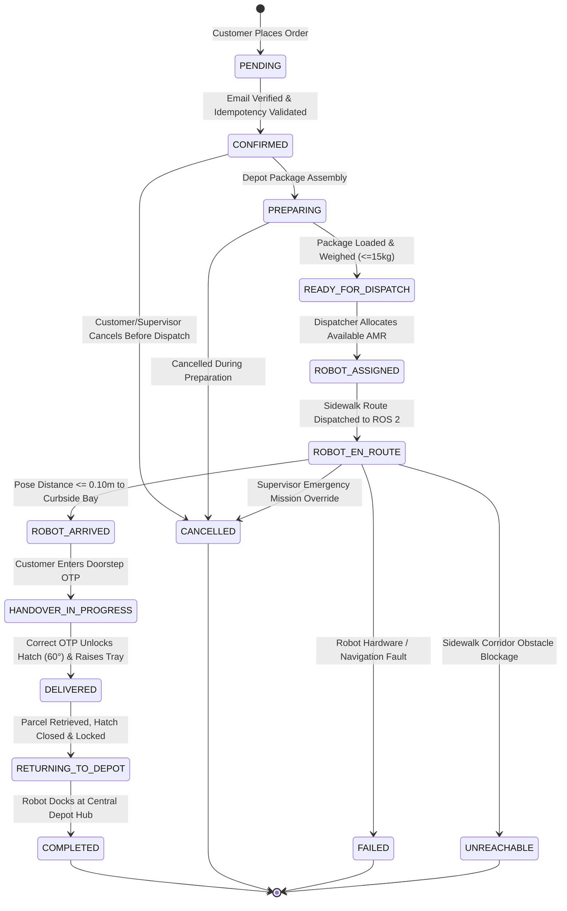

# NexusDelivery — Customer-to-Autonomous-Robot Delivery Workflow

## 1. Executive Architecture Overview

The **NexusDelivery** autonomous delivery platform orchestrates a vision-led, zero-LiDAR, zero-GPS sidewalk autonomous mobile robot (AMR) system integrated with a customer commerce portal and industrial fleet supervisor cockpit.

This document specifies the complete, functional end-to-end customer order lifecycle implemented on top of RDSim, Gazebo Classic 11 simulation, and ROS 2 Humble.

---

## 2. Standard 14 Order Lifecycle States

NexusDelivery enforces 14 discrete, sequential order states in the SQLite transactional database (`results/nexus_delivery.db`), mission dispatcher (`delivery_robot_sim/mission_dispatcher.py`), and web bridge API (`delivery_robot_sim/web_bridge_node.py`):

| Order State | Trigger Event | Autonomous Actions & Hardware Actuation |
| :--- | :--- | :--- |
| **`PENDING`** | Customer clicks "Confirm & Dispatch" in cart. | Validates session token, tenant identity, and email verification status (`email_verified == 1`). Rejects unverified accounts with HTTP 403 `EMAIL_UNVERIFIED`. |
| **`CONFIRMED`** | Payload weight ($\le 15.0\text{ kg}$) and volume ($\le 22.5\text{ L}$) validated. | Idempotency key verified to prevent duplicate submissions. Generates single-use 6-digit OTP (`secrets.randbelow`). |
| **`PREPARING`** | Depot preparation initiated. | Items packed into temperature-controlled, sealed robot container. |
| **`READY_FOR_DISPATCH`** | Package loaded into AMR bay. | Solenoid locks compartment door (`0.0^\circ`). Weight and volume cross-checked against chassis limits. |
| **`ROBOT_ASSIGNED`** | Dispatcher matches order to available robot. | Fleet allocator evaluates AMR battery state of charge ($\ge 20\%$), health diagnostics, and depot proximity. |
| **`ROBOT_EN_ROUTE`** | Navigation goals dispatched to ROS 2 `/cmd_vel`. | Pure pursuit path tracker engages sidewalk waypoints. AI YOLO perception actively monitors ground plane corridor. |
| **`ROBOT_ARRIVED`** | Distance to stopping bay $\le 0.10\text{ m}$. | Chassis comes to safe standstill ($\mathbf{v} = 0.00\text{ m/s}, \mathbf{\omega} = 0.00\text{ rad/s}$). Client notified of arrival. |
| **`HANDOVER_IN_PROGRESS`** | Customer arrives at doorstep vehicle bay. | Customer enters 6-digit OTP on web portal or vehicle touch screen. |
| **`DELIVERED`** | Correct 6-digit OTP verified against cryptographic hash. | Solenoid unlatches cargo door, electric linear actuator raises hatch to $60.0^\circ$ ($1.05\text{ rad}$), scissor lift raises tray by $0.12\text{ m}$. Handover timestamp logged. |
| **`RETURNING_TO_DEPOT`** | Customer clicks "Package Retrieved" or timeout expires. | Lift lowers tray to $0.00\text{ m}$, motorized hatch closes to $0.0^\circ$ and latches. Robot replans sidewalk route back to Central Logistics Depot (`-31.50, -0.75`). |
| **`COMPLETED`** | AMR docks at Central Logistics Depot charging bay. | Mission successfully finalized. Robot returns to `IDLE_AT_DEPOT` ready for next assignment. |
| **`CANCELLED`** | Safe cancellation request received. | Allowed while in `PENDING`, `CONFIRMED`, or `PREPARING`. Prohibited for customer once `ROBOT_EN_ROUTE` (requires Supervisor override). |
| **`FAILED`** | Hardware anomaly or motor bus error detected. | Safety supervisor FSM halts motors, engages E-Stop, and logs cryptographic audit failure record. |
| **`UNREACHABLE`** | Static obstacle blocks all alternate sidewalk paths. | Robot halts at safe standoff distance, reports obstruction to supervisor cockpit, and awaits operator clearance. |

---

## 3. Customer-to-Robot End-to-End Workflow

### Step 1: Customer Registration & Email Verification (Phase 1)
1. Customer registers via `/client` with name, email, phone, password, and street address.
2. Backend computes PBKDF2-HMAC-SHA256 password hash (100,000 iterations, 32-byte salt).
3. System creates user record with `email_verified = 0`.
4. High-entropy verification token (32 bytes url-safe base64, 256 bits of entropy) is generated and stored in `email_verifications` table with a 24-hour expiration timestamp.
5. Email service dispatches verification email via live SMTP (or records to `results/email_outbox.json` when running in offline development mode).
6. 60-second rate-limiting is enforced on `resend_verification`.
7. Unverified customers are prohibited from placing orders (HTTP 403 `EMAIL_UNVERIFIED`).
8. Clicking verification link activates account (`email_verified = 1`) and invalidates the token to prevent replay attacks.

### Step 2: Interactive Doorstep Destination Selection (Phase 2)
1. Customer views vector map of Gazebo simulation city grid with sidewalk paths, curbside bays, building blocks, and crosswalks.
2. Customer drags delivery pin to target doorstep location.
3. Client dispatches `POST /api/destination/validate` with coordinates $(x, y)$.
4. Validator checks operational design domain (ODD) boundaries ($X \in [-35.0, 10.0]\text{ m}, Y \in [-25.0, 25.0]\text{ m}$).
5. Validator checks building footprint polygons (`BUILDING_BLOCKS`) to ensure pins cannot be placed inside solid structures or private property.
6. Validator snaps target to nearest legal sidewalk delivery bay, returns route distance and realistic estimated transit duration.

### Step 3: Order Placement & Payload Validation (Phase 3)
1. Customer selects catalog products into shopping cart.
2. System computes total weight and volume. If weight exceeds 15.0 kg or volume exceeds 22.5 L, order placement is blocked.
3. Frontend submits `idempotency_key` (UUID v4 + timestamp) to prevent duplicate submissions.
4. Database commits order in atomic transaction and generates a single-use 6-digit OTP code (`000000`–`999999`).

### Step 4: Mission Dispatcher Allocation (Phase 4)
1. Fleet allocator checks robot telemetry: battery voltage ($\ge 24.0\text{ V}$), mission state (`IDLE_AT_DEPOT`), and hardware health.
2. System transitions order to `ROBOT_ASSIGNED` and generates Dijkstra waypoint route along legal sidewalk corridors.
3. Web bridge transmits goal coordinate to ROS 2 navigation stack.

### Step 5: Truthful Live Telemetry Tracking (Phase 5)
1. Customer portal polls `/api/telemetry` every 1000 ms.
2. Telemetry provenance is strictly classified and displayed:
   - `● LIVE GAZEBO (GROUND TRUTH)`: Odometry timestamp age $< 2.0\text{ s}$. True Gazebo model state pose from `/odom`.
   - `▲ LAST KNOWN POSITION (CACHED)`: Odometry age $2.0\text{ s} \le t \le 15.0\text{ s}$. Robot stopped, displaying cached coordinate.
   - `✖ TELEMETRY UNAVAILABLE (SIM OFFLINE)`: Simulation offline. Robot velocity clamped to $0.00\text{ m/s}$.
3. GPS coordinates are clearly watermarked with `MATHEMATICAL_PROJECTION_FOR_DISPLAY_ONLY`.
4. Estimated arrival time (ETA) is displayed only when vehicle has active motion and distance $> 0.1\text{ m}$; otherwise displays "STANDBY" or "ARRIVED AT DOORSTEP".

### Step 6: Arrival & 6-Digit OTP Handover (Phase 6)
1. As the AMR approaches the stopping bay, arrival detection triggers when Euclidean distance $d = \sqrt{(x - x_{\text{bay}})^2 + (y - y_{\text{bay}})^2} \le 0.10\text{ m}$.
2. AMR stops safely ($\mathbf{v} = 0.00\text{ m/s}$). Order status transitions to `ROBOT_ARRIVED`.
3. Customer opens 6-digit OTP modal and inputs code.
4. On code validation, solenoid releases lock, motorized hatch opens to $60.0^\circ$ ($1.05\text{ rad}$), scissor lift raises parcel tray by $0.12\text{ m}$, and status marks `DELIVERED`.
5. Customer retrieves package and clicks "Package Retrieved".
6. System lowers cargo tray ($0.00\text{ m}$), closes hatch ($0.0^\circ$), engages solenoid lock, and updates status to `RETURNING_TO_DEPOT`.
7. AMR navigates back to Central Logistics Depot docking bay and enters `COMPLETED`.

---

## 4. Safety and Cancellation Matrix

| Current Order Status | Customer Allowed to Cancel? | Supervisor Allowed to Cancel? | Resulting Status |
| :--- | :--- | :--- | :--- |
| `PENDING` | Yes | Yes | `CANCELLED` |
| `CONFIRMED` | Yes | Yes | `CANCELLED` |
| `PREPARING` | Yes | Yes | `CANCELLED` |
| `READY_FOR_DISPATCH` | Yes | Yes | `CANCELLED` |
| `ROBOT_ASSIGNED` | No (dispatched) | Yes (override) | `CANCELLED` (AMR aborts) |
| `ROBOT_EN_ROUTE` | No (vehicle in motion) | Yes (emergency abort) | `CANCELLED` (AMR returns to depot) |
| `ROBOT_ARRIVED` | No (at doorstep) | Yes (override) | `CANCELLED` (AMR returns to depot) |
| `HANDOVER_IN_PROGRESS`| No (OTP active) | Yes (override) | `CANCELLED` |
| `DELIVERED` | No (handover complete) | No (already completed) | Rejected |
| `RETURNING_TO_DEPOT` | No | No | Rejected |
| `COMPLETED` | No | No | Rejected |
